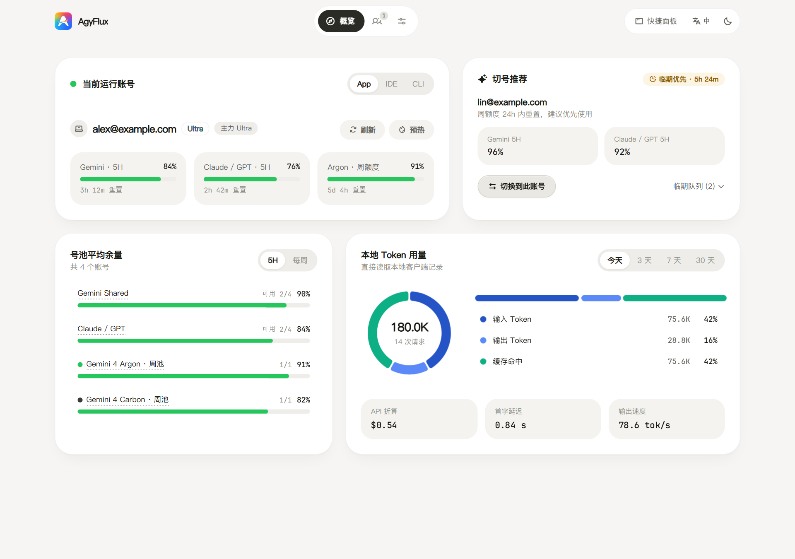
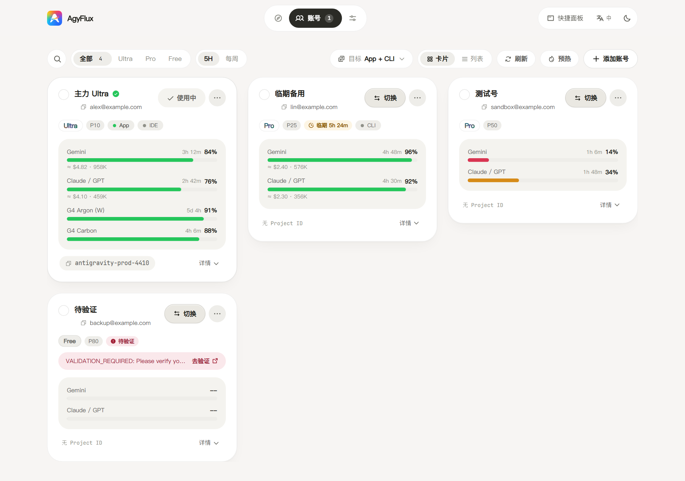

# AgyFlux

面向 **Google Antigravity** 的多账号管理与额度监控桌面客户端，基于 React 19、TypeScript、Tauri 2 与 Rust 构建，并附带同源命令行工具 `agyflux`。

<!-- 图片注释 -->




## 核心特性

- **多方式账号接入**：支持 Google OAuth 登录（S256 PKCE 校验、浏览器偏好记忆、5 分钟会话超时与手动回调兜底）、Refresh Token / JSON 批量导入导出，以及从本地客户端直接读取。
- **多客户端精确切换**：独立识别并切换 `App`、`IDE`、`CLI (agy)` 与 `VS Code`，明确区分「运行中会话」、「已保存凭据」与未确认状态；支持账号备注、优先级调度与设备指纹绑定/备份。
- **额度与本地用量看板**：汇总 5 小时 / 每周额度窗口、Gemini 4 Argon / Carbon 周池及临期重置提醒，支持 API 等效价值折算；自动读取本地客户端记录，展示输入 / 输出 / 缓存 Token 占比、首字延迟与输出速度。
- **智能推荐与后台自动切号**：根据余量与重置倒计时自动推荐备用账号；支持按触发阈值、基准模型、优先级（P 值）或轮换策略后台切换，可配置「空闲时安全切换」与低余量模型保护。
- **托盘快捷面板与外观**：提供轻量常驻的快捷面板（支持窗口置顶、快速切号与号池概览），支持浅色 / 深色 / 跟随系统主题及简体中文 / English 双语切换。

## 快速开始

### 桌面端使用与数据隔离

- **数据目录**：默认沿用 `~/.antigravity_tools`，与既有本地账号结构兼容；如需与其他管理工具隔离数据，可通过环境变量 `ABV_DATA_DIR` 指定独立目录（避免多工具并发写入同一目录造成冲突）。
- **包与标识**：npm / Cargo 包名为 `agyflux`，桌面端主程序为 `agyflux-desktop`，CLI 为 `agyflux`，应用标识为 `com.agyflux.app`。
- **更新策略**：当前独立版本统一为 `1.0.0`，已关闭上游自动更新通道，不会拉取或覆盖其他分支的发行包。

### 本地开发

需要准备 **Node.js 22**、**Rust stable** 以及对应平台的 Tauri 2 构建依赖（Windows 原生构建需安装 Visual Studio C++ Build Tools 与 WebView2）。

```powershell
npm ci
npm run dev
```

`npm run dev` 会启动基于内置模拟数据的 Vite 浏览器预览（端口 `1420`），不会读取或修改真实 `~/.antigravity_tools` 数据，按 `Ctrl+C` 即可停止。

如需启动连接 Rust 后端的完整桌面窗口，建议先指定独立测试目录再运行：

```powershell
$env:ABV_DATA_DIR = './.local-data'
npm run tauri dev
```

## 测试与构建

```powershell
npm test                  # 前端单元测试
npm run build             # TypeScript 检查与 Vite 生产构建
npm run test:backend      # Rust 后端单元测试（使用临时目录与合成数据）
npm run check:backend     # Rust 全目标编译检查
npm run icons             # 从母版重新生成桌面与网页图标
```

> **提示**：后端测试默认跳过依赖真实凭据库或真实客户端进程的用例；请勿在日常账号目录下执行 `cargo test -- --ignored`。

在具备 Windows 原生 Rust 与 MSVC 工具链的环境中，可直接运行 `src-tauri\build.bat` 构建 `agyflux` CLI 与 NSIS 安装包（产物默认输出至 `release/windows-x64/`，不纳入 Git 版本控制）。

## 相关文档

- [登录流程整合说明](docs/cc-switch-login.md) — OAuth 会话生命周期、PKCE 与手动回调机制
- [后端修复与架构边界](docs/backend-repair.md) — 状态一致性、凭据边界与后续演进方向
- [Windows 打包与验证记录](docs/windows-package-validation.md) — 交叉构建流程、安装包结构与原生校验清单
- [品牌图标与资源说明](assets/branding/README.md) — 图标母版与多分辨率导出规范

## 致谢与许可

AgyFlux 在多款优秀开源工具的启发与基础上演进：

| 参考项目 | 参考提交 | 借鉴与承接内容 |
| --- | --- | --- |
| [agy-switch](https://github.com/anglee0323/agy-switch) | `1f8085e` | 账号存储结构、本地客户端切换、自动调度及测试夹具 |
| [Antigravity-Manager](https://github.com/lbjlaq/Antigravity-Manager) | `9b82fb7e` | 原始账号与号池管理架构参考 |
| [CC Switch](https://github.com/farion1231/cc-switch) | `ed6d51e590ff8a34431ca60eacfc78e12704075b` | 授权中心交互流程、登录会话管理与 Google PKCE 实现思路（v4.0.33） |

- 本项目整体沿用 [CC-BY-NC-SA-4.0](LICENSE) 协议，并保留原项目来源声明。
- 参考自 CC Switch 的相关设计与授权交互，其原始 MIT 许可声明保留于 [third-party/cc-switch.LICENSE](third-party/cc-switch.LICENSE)。
